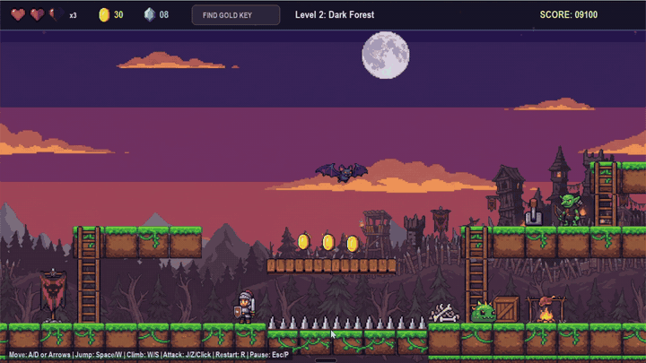
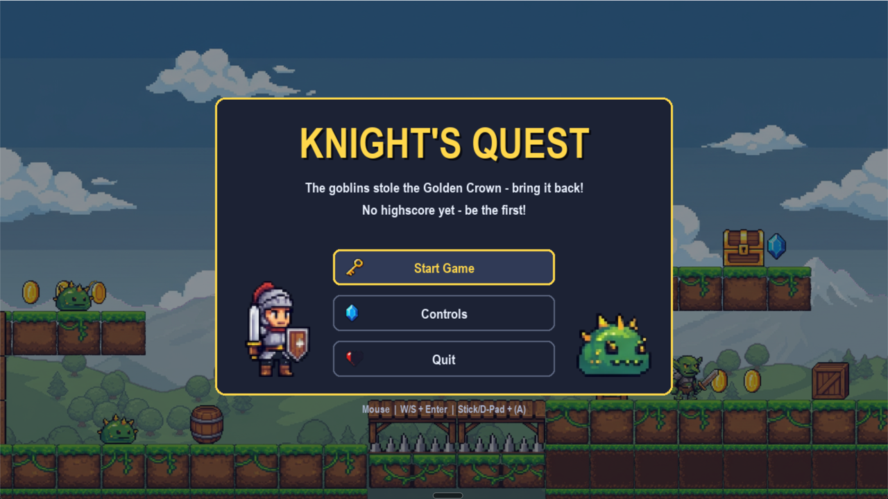
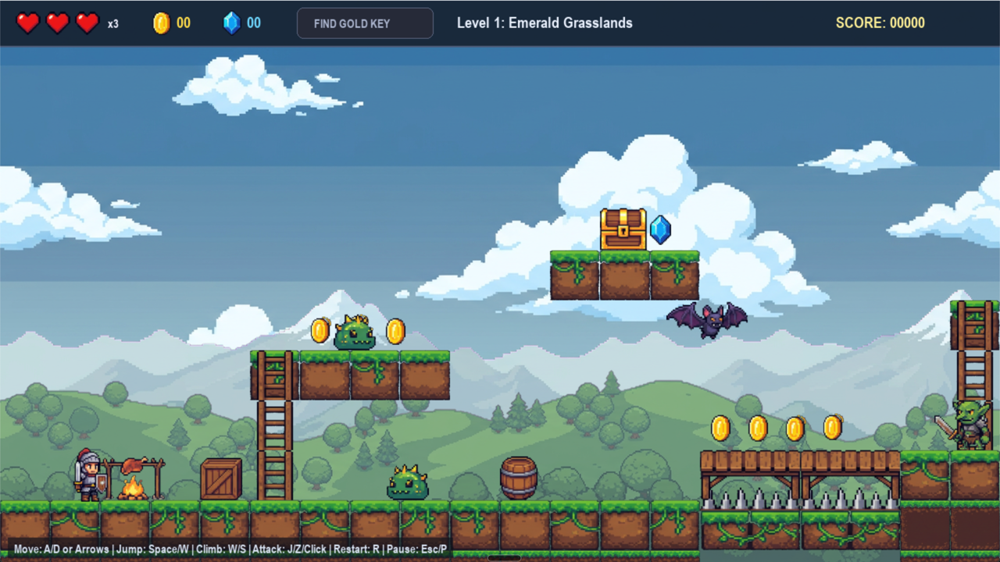
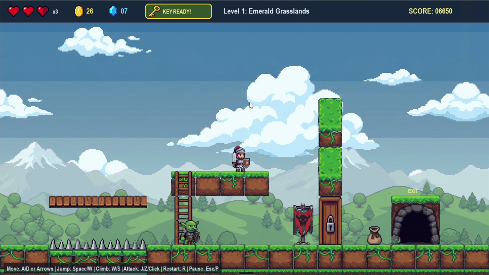
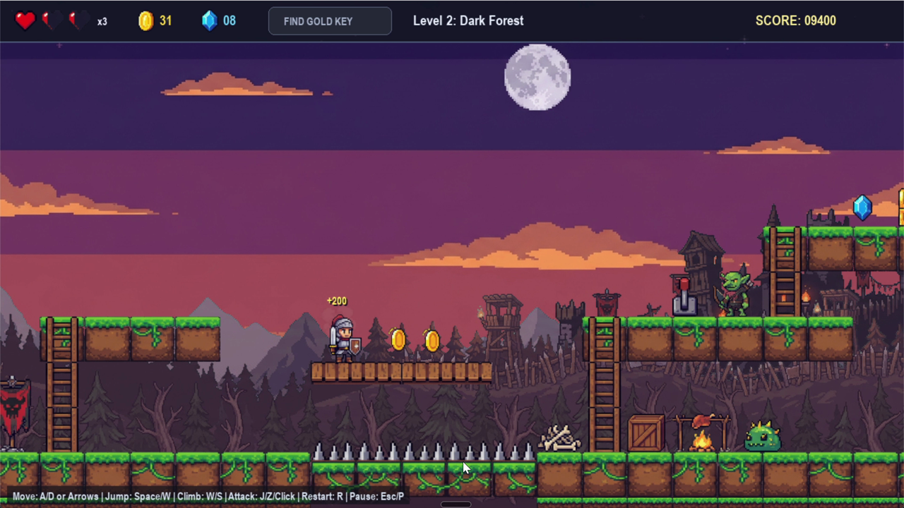
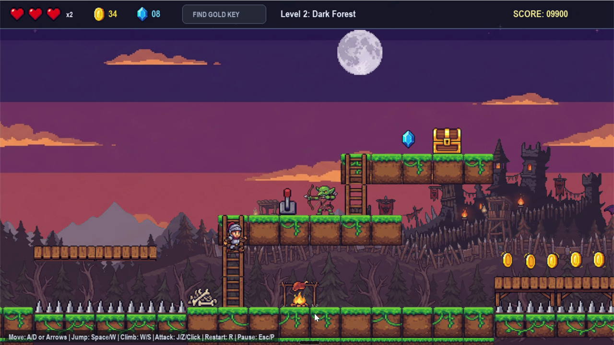
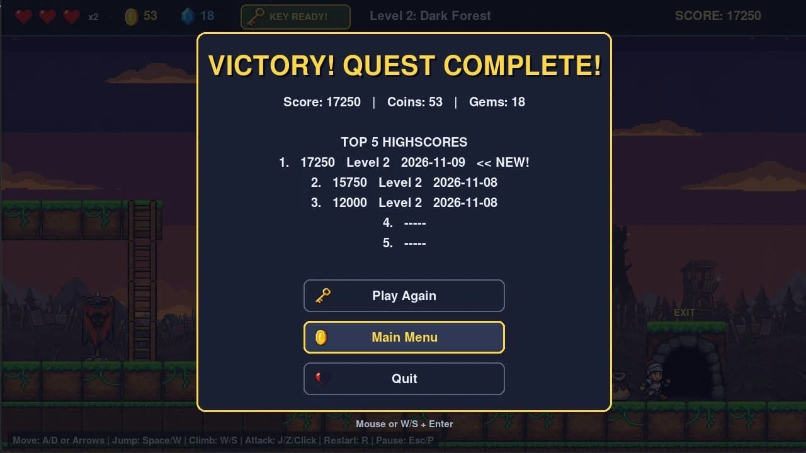
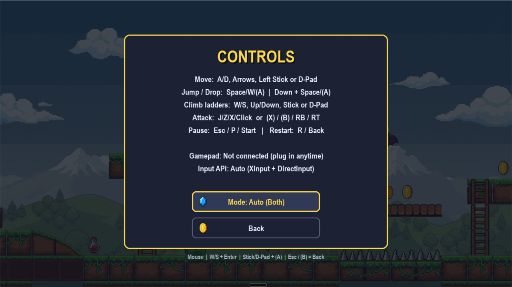

<div align="center">

# Knight's Quest: The Stolen Crown

**A knight. A stolen crown. Two levels, one boss, and a very short list of ways to die.**




</div>

---

## 1. Overview

**Knight's Quest** is a 2D side-scrolling action-platformer written in Python with pygame-ce. You play Aldric, a knight whose kingdom has lost its Golden Crown to a goblin raid. You get it back by running, jumping, climbing and hitting things with a sword.

That is the whole pitch. If you've played a platformer before, you already know how to play this one. If you haven't, the controls are below and it will take you about a minute.

| | |
| :--- | :--- |
| **Genre** | Action platformer |
| **Perspective** | 2D side-scrolling, 1280 × 720 at 60 FPS |
| **Players** | One |
| **Input** | Keyboard and mouse, or any gamepad |
| **Length** | Two levels, roughly five minutes a run |
| **Target** | Windows, macOS and Linux, Python 3.10+ |

### Who this is for

Someone who wants a short, honest game they can start in under a minute and beat the high score on. Also: anyone grading it, who would like to see the requirements without hunting for them. They're in section 6.

---

## 2. See It Before You Install It

<table>
  <tr>
    <td><br><sub><b>Main menu.</b> Mouse, keyboard or controller.</sub></td>
    <td><br><sub><b>Level 1.</b> Emerald Grasslands.</sub></td>
  </tr>
  <tr>
    <td><br><sub><b>The key.</b> Get it, unlock the gate, reach the exit.</sub></td>
    <td><br><sub><b>Level 2.</b> The Dark Forest.</sub></td>
  </tr>
  <tr>
    <td><br><sub><b>Pause menu.</b></sub></td>
    <td><br><sub><b>Victory.</b> Your top five are saved.</sub></td>
  </tr>
</table>

---

## 3. Install and Run

You need **Python 3.10 or newer** ([python.org/downloads](https://www.python.org/downloads/)). On Windows, tick **"Add python.exe to PATH"** in the installer. It's the single most common reason this fails, so we're saying it twice.

**Windows**

```powershell
git clone https://github.com/akhil-kk15/PythonSideScroller_game.git
cd PythonSideScroller_game
py -m venv .venv
.venv\Scripts\python -m pip install -r requirements.txt
.venv\Scripts\python main.py
```

**macOS and Linux**

```bash
git clone https://github.com/akhil-kk15/PythonSideScroller_game.git
cd PythonSideScroller_game
python3 -m venv .venv
.venv/bin/python -m pip install -r requirements.txt
.venv/bin/python main.py
```

No Git? Use **Code → Download ZIP**, unzip it, open a terminal in the folder that contains `main.py`, and run the last three lines.

Next time, just run the last line. Everything else is already done. Sprites ship with the repository and are prepared automatically on first launch.

---

## 4. Core Gameplay

### 4.1 The goal

In each level, find the **Gold Key**, use it to open the **locked gate**, and walk into the **cave exit**. Do it in Level 1 (Emerald Grasslands), then again in Level 2 (Dark Forest, where the Goblin Brute lives). Beat both and the crown comes home.

### 4.2 What you can do

Move, jump (tap to hop, hold to go high), climb ladders, drop through wooden bridges, and swing the sword in a three-hit combo. The game is generous about timing: it remembers a jump you pressed slightly early and allows one you pressed slightly late. This is deliberate. Nobody has ever enjoyed missing a jump by two frames.

### 4.3 How you lose

You have **3 lives**, and each life has **3 hearts**. Lose all your hearts and the level restarts. Lose all your lives and the run is over. Health potions restore a heart.

### 4.4 Enemies

| Enemy | Health | Damage | What it does | Points |
| :--- | :---: | :---: | :--- | ---: |
| Slime | 1 | 1 | Patrols, chases when you get close | 150 |
| Bat | 1 | 1 | Flies, then swoops | 200 |
| Goblin Warrior | 2 | 2 | Chases, raises its weapon, strikes. Dodge the wind-up | 300 |
| Goblin Archer | 2 | 1 | Stands still and fires arrows | 350 |
| Goblin Brute | 4 | 3 | Slow and heavy. Its swing cannot be interrupted | 800 |

### 4.5 Scoring

| Action | Points |
| :--- | ---: |
| Coin | 100 |
| Blue gem | 250 |
| Health potion | 150 (plus one heart) |
| Gold key | 500 |
| Smash a crate or barrel | 50 |
| Open a chest | 300 (plus 3 coins and 1 gem) |
| Reach a level exit | 1,000 |

Pull a lever and three bonus gems appear. Your best five runs are saved, with the level reached and the date.

---

## 5. Controls

| Action | Keyboard and mouse | Gamepad |
| :--- | :--- | :--- |
| Move | `A` `D` or `←` `→` | Left stick or D-pad |
| Jump | `Space`, `W` or `↑` | `A` or `LB` |
| Drop through a bridge | Hold `S`/`↓`, press `Space` | Hold Down, press `A` |
| Climb | `W` `S` or `↑` `↓` | Left stick or D-pad |
| Attack | `J` `Z` `X` `F` `K` or left click | `X` `B` `Y` `RB` or `RT` |
| Pause | `Esc` or `P` | `Start` |
| Restart level | `R` or `Enter` | `Back` / `Select` |
| Menus | Mouse, or `W`/`S` + `Enter` | Stick or D-pad + `A` (`B` = back) |
| Cutscenes | `Enter` / `Space` / click = next, `Esc` = skip | `A` = next, `B` or `Start` = skip |

You can plug in a controller at any time, even mid-level.

<details>
<summary><b>The in-game Controls screen</b></summary>
<br>

</details>

---

## 6. Requirements

We wrote these down so nobody has to guess what the game is supposed to do.

### 6.1 Functional

| ID | The game must... |
| :--- | :--- |
| FR-1 | let the player move, jump at variable height, climb ladders, drop through bridges and attack with a three-hit combo |
| FR-2 | provide two levels with distinct layouts, parallax backgrounds, spike hazards and interactive props (crates, chests, levers, a locked gate) |
| FR-3 | provide five enemy types with different behaviour: patrol and chase, swoop, telegraphed melee, ranged attack, and an uninterruptible boss swing |
| FR-4 | gate progress in each level behind a key and a locked gate |
| FR-5 | show health, lives, coins, gems and score at all times |
| FR-6 | offer main, pause, controls, game-over and victory menus usable by mouse, keyboard and gamepad |
| FR-7 | play animated story cutscenes before Level 1, before Level 2 and at the ending |
| FR-8 | save a top-five leaderboard to `highscores.txt` |
| FR-9 | support gamepads that can be plugged in at any time, in Auto, XInput or DirectInput mode |

### 6.2 Non-functional

| ID | The game must... |
| :--- | :--- |
| NFR-1 | run at 60 FPS in a 1280 × 720 window |
| NFR-2 | need only Python 3.10+ and one dependency, `pygame-ce` |
| NFR-3 | run on Windows, macOS and Linux |
| NFR-4 | need nothing beyond `pip install`; sprites are prepared automatically on first launch |
| NFR-5 | forgive near-miss input (jump buffering and coyote time) |

### 6.3 Not included

Online multiplayer, multiple save slots, and a level editor. This is a two-level game and it knows it.

---

## 7. Under the Hood

```
main.py         Game loop, HUD, state machine, level interactions
player.py       Knight physics, ladders, jump buffering, combo attacks
level.py        Level 1 and 2 layouts, enemy AI, collectibles, projectiles
story.py        Animated pixel-art cutscenes
ui.py           Mouse, keyboard and gamepad menus
joystick.py     XInput and DirectInput controller support with hot-plug
highscores.py   Persistent top-five leaderboard
background.py   Parallax scrolling backgrounds
animation.py    Sprite animation system
slice_assets.py Cuts the master sprite sheets into individual PNGs
assets/         Sprite sheets, sliced sprites and backgrounds
```

Useful for developers:

```bash
python main.py --controller-mode auto          # or: xinput, directinput
python -m compileall -q *.py                   # syntax check
python slice_assets.py                         # re-slice assets/base.jpg, knight.jpg, goblin.jpg
```

Press `1` or `2` in-game to jump straight to a level (that run's score isn't saved). Delete `highscores.txt` to reset the leaderboard.

---

## 8. When Something Goes Wrong

<details>
<summary><b>"python", "py" or "python3" is not recognized</b></summary>

Python isn't installed, or isn't on your `PATH`. Install Python 3.10+. On Windows, re-run the installer, choose **Modify**, enable **Add python.exe to PATH**, then reopen your terminal.
</details>

<details>
<summary><b>"No such file or directory: requirements.txt" or "main.py"</b></summary>

Your terminal isn't in the game folder. `cd PythonSideScroller_game` (or `PythonSideScroller_game-main` if you used the ZIP) and try again.
</details>

<details>
<summary><b>"No module named pygame"</b></summary>

Start the game with the virtual environment's Python: `.venv\Scripts\python main.py` (Windows) or `.venv/bin/python main.py` (macOS/Linux).
</details>

<details>
<summary><b>PowerShell: "running scripts is disabled on this system"</b></summary>

You don't need to activate the environment. Call `.venv\Scripts\python` directly, as shown above.
</details>

<details>
<summary><b>Linux: "ensurepip is not available"</b></summary>

```bash
sudo apt update && sudo apt install -y python3-venv
```
</details>

<details>
<summary><b>My controller does nothing, or the buttons feel swapped</b></summary>

Open **Controls** from the main or pause menu, check the Gamepad status line, and click **Mode** to switch between Auto, XInput (Xbox-style) and DirectInput (classic USB or Bluetooth). Or launch with `--controller-mode xinput` or `--controller-mode directinput`.
</details>
